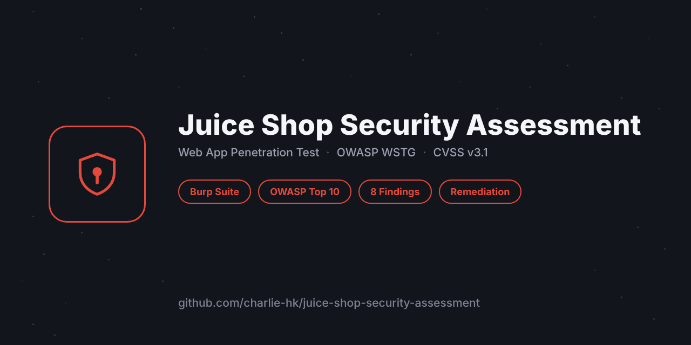

# Juice Shop Security Assessment

A full web-application penetration test of **OWASP Juice Shop**, carried out and
documented the way a real engagement would be: structured against the **OWASP Web
Security Testing Guide (WSTG v4.2)**, findings rated with **CVSS v3.1**, each one written
up with reproduction steps, impact, evidence and remediation.

> **Scope & authorisation.** The target is OWASP Juice Shop, an application OWASP
> publishes *specifically* so people can practise security testing. It was run on a
> local instance owned by the tester (`docker run -p 3000:3000 bkimminich/juice-shop`).
> No third-party or production system was touched. This is a lab assessment; the
> methodology, tooling and report format mirror professional practice so the work is
> representative.

## What this repository is

A complete assessment deliverable, not a tutorial:

- A **methodology** grounded in OWASP WSTG and PTES phases.
- **Eight confirmed findings** across authentication, authorization, session management,
  input validation, configuration and business logic — each with a CVSS vector,
  reproduction steps and a concrete fix.
- A **remediation guide** that generalises the findings into reusable engineering
  controls.
- A **WSTG coverage checklist** showing what was tested.

## Findings summary

| ID | Finding | WSTG | Severity | CVSS |
|----|---------|------|----------|------|
| JS-01 | SQL injection authentication bypass | INPV-05 / ATHN-04 | **Critical** | 9.8 |
| JS-02 | IDOR on baskets (broken access control) | ATHZ-04 | High | 8.1 |
| JS-03 | Administration panel privilege escalation | ATHZ-02 | High | 8.8 |
| JS-04 | Forgeable JWT session token | ATHN / SESS | High | 8.1 |
| JS-05 | Stored / DOM cross-site scripting | INPV-01/02 | High | 7.2 |
| JS-06 | Exposed backup & configuration files | CONF-04 | Medium | 6.5 |
| JS-07 | Security misconfiguration (errors, headers) | CONF-02 / ERRH | Medium | 5.3 |
| JS-08 | Business logic data-validation abuse | BUSL-01/02 | Medium | 5.3 |

## Repository layout

```
report/
  executive-summary.md   Non-technical overview and risk ratings
  methodology.md         Standard, scope, phases, tooling, severity model
  findings.md            The eight findings in full detail
remediation/
  secure-coding-guide.md Reusable controls derived from the findings
tooling/
  wstg-checklist.md      OWASP WSTG v4.2 coverage
assets/
  cover.png
```

## How to reproduce

1. Run a local instance: `docker run --rm -p 3000:3000 bkimminich/juice-shop`
2. Point an intercepting proxy (Burp Suite / OWASP ZAP) at `http://localhost:3000`.
3. Work through `report/findings.md`; each finding lists the exact request and payload.

## Methodology

OWASP **WSTG v4.2** for test coverage, **CVSS v3.1** for severity, reported along the
PTES phases. See `report/methodology.md` for the full approach and tooling.

## Author

**Ali Amini** — [linkedin.com/in/ali-amini-65b423185](https://linkedin.com/in/ali-amini-65b423185)

## License & attribution

This assessment is released under the MIT License. OWASP Juice Shop is a separate project
by the OWASP Foundation, used here under its own license as an authorised testing target.
